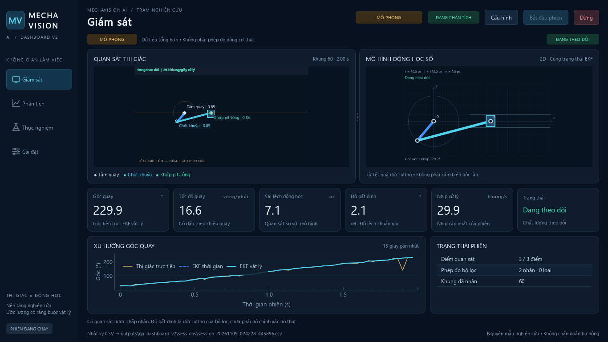

# Dashboard V2 — Không gian nghiên cứu và giám sát

Dashboard V2 tổ chức lại giao diện thành bốn trang, dùng cùng pipeline nhận diện và ước lượng hiện có. Không có dữ liệu điền sẵn để trang trí, không thay đổi EKF/động học và không bổ sung phụ thuộc nặng.



## Sử dụng

1. Mở `python -m mechavision gui` hoặc `run_windows.bat` sau khi cài nhóm `gui`.
2. Mở **Cài đặt** để chọn nguồn, bộ nhận diện, hình học và trọng số khi cần. Mô phỏng dùng cấu hình mặc định của Simulator; các trường không liên quan được vô hiệu hóa.
3. Nhấn **Bắt đầu phiên**. **Giám sát** ưu tiên hai viewport, KPI và chất lượng theo dõi. Kéo splitter để đổi tỷ lệ camera/mô hình số; ảnh giữ đúng tỷ lệ và vẽ lại khi đổi kích thước.
4. Mở **Phân tích** để xem góc quay, vận tốc, độ bất định và sai lệch động học. Có thể ẩn/hiện phương pháp, chọn cửa sổ 15/30/60 giây hoặc toàn bộ bộ đệm, tắt theo thời gian để xem một vùng và xuất biểu đồ bằng menu hoặc nút xuất.
5. **Thực nghiệm** gọi các hàm đánh giá hiện có trên luồng nền. Chọn mô phỏng hoặc CSV quan sát + CSV tham chiếu + hình học. Mỗi lần chạy tạo một thư mục JSON/CSV riêng; bảng kết quả chỉ xuất hiện khi đánh giá đã hoàn tất. Nhật ký phiên chỉ chứa những phiên thực sự khởi chạy trong lần mở ứng dụng.
6. Nhấn **Dừng** để kết thúc thu nhận trước khi đổi nguồn. Dữ liệu còn trên màn hình được ghi rõ là mẫu cuối của phiên đã dừng.

## Nguồn dữ liệu và chất lượng

- **Mô phỏng**: dữ liệu tổng hợp, luôn có nhãn cảnh báo. Các con số trong ảnh minh họa là kết quả thực sự của Simulator/Processor, không phải đo động cơ thực.
- **Camera trực tiếp**: cần camera khả dụng và hiệu chuẩn cơ cấu. Lỗi mở nguồn được thông báo; không tự chuyển sang mô phỏng.
- **Video đã ghi**: cần xác minh nguồn gốc video và cấu hình hình học. Video tự nó chưa chứng minh một phép đo thực đã được kiểm chứng.
- **Đang theo dõi**: có quan sát được bộ lọc chấp nhận, biểu thị bằng teal; chưa phải bảo đảm độ chính xác đo thực.
- **Đang dự báo**: kết quả dự báo ngắn hạn của bộ lọc, được đánh dấu amber trên giao diện và mô hình số.
- **Mất dấu / không đủ độ tin cậy**: ngừng vẽ cơ cấu chuyển động, góc/RPM để trống; không giữ một hoạt ảnh quay giả. Lỗi nguồn được phân biệt với trạng thái mất dấu.

Độ bất định là σθ do bộ lọc ước lượng, không đổi thành phần trăm tin cậy tự đặt. FPS là nhịp xử lý hiện có, không được trình bày như benchmark GPU hay độ trễ toàn trình. Sai lệch động học không phải kết luận hư hỏng. Thị giác trực tiếp chỉ có góc; vận tốc và σθ được so sánh giữa hai EKF theo kết quả sẵn có.

## Design system và kiến trúc

Nền navy/graphite, cyan và electric blue cho dữ liệu, teal cho theo dõi hợp lệ, amber cho cảnh báo, red cho mất dấu/lỗi. Segoe UI hỗ trợ tiếng Việt trên Windows; giữ cơ chế phông Unicode của dự án trên nền tảng khác. Khoảng cách dùng thang 4/8/12/16/24; panel radius 10, KPI radius 9, điều khiển radius 6, đường viền mảnh. Icon điều hướng được vẽ bằng Qt, không thêm bộ thư viện icon hoặc hiệu ứng trang trí nặng.

| Module | Trách nhiệm |
|---|---|
| `dashboard_theme.py` | Token màu, typography, stylesheet và palette Qt |
| `dashboard_widgets.py` | Panel, badge, KPI, bảng và viewport giữ tỷ lệ |
| `dashboard_shell.py` | Sidebar, topbar, điều hướng và stack trang |
| `dashboard_state.py` | Trạng thái phiên và chuỗi kết quả hiển thị, tối đa 3.600 mẫu |
| `dashboard_controller.py` | Thu nhận/nhận diện/ước lượng/ghi CSV và đánh giá trên QThread |
| `dashboard_monitoring.py`, `dashboard_analytics.py` | Giám sát và phân tích |
| `dashboard_experiments.py`, `dashboard_settings.py` | Thực nghiệm và cấu hình |
| `gui.py`, `qt_support.py` | Điều phối phiên, điểm vào ứng dụng, hộp thoại và xuất Unicode |

Digital Twin dùng `Estimate.theta` và `Geometry` của cùng mẫu xử lý. Những thay đổi ở `render.py` và lớp phủ trong `detection.py` chỉ phục vụ hiển thị: bố trí chữ, đường nối quan sát, trục, khớp và phép biến đổi vào viewport. Các lớp nhận diện, công thức hình học, EKF, cấu trúc CSV/JSON và các hàm đánh giá được giữ nguyên.

## Kiểm chứng và ảnh

Ngày 09/11/2026: **53 kiểm thử đạt** trên Windows/Python 3.12.13, gồm toàn bộ 30 kiểm thử trước nâng cấp. Đã chạy ứng dụng Windows native và kiểm tra tự động bằng QWidget/QTest thật. Lượt native và offscreen đều qua các tương tác bắt đầu, dừng, chuyển trang khi đang chạy, đánh giá nền và đọc video qua detector/EKF.

Các ảnh bên dưới có kích thước pixel đúng 1366×768 và 1920×1080, được chụp bằng Qt offscreen sau khi chạy pipeline thật. Có kiểm tra bổ sung ở vùng nội dung 1366×700 để dự phòng thanh tiêu đề/taskbar. Đã xem trực quan các trang và kiểm tra biên chữ; lượt QA offscreen tạo 16 ảnh và ghi nhận **0 nhãn Qt bị cắt**. Lượt Windows native tạo 13 ảnh và cũng ghi nhận 0 lỗi biên chữ. Trên màn hình host có DPI 125%, đã kiểm tra thêm hệ số thu phóng riêng tiến trình để ảnh native về DPR 1; vùng client native có thể bị hệ điều hành giới hạn theo thanh tiêu đề/taskbar. Không suy rộng thành chứng nhận cho mọi cấu hình DPI/hệ điều hành.

| Trang | 1366×768 | 1920×1080 |
|---|---|---|
| Giám sát | [Ảnh](../assets/dashboard-v2/monitoring-1366x768.png) | [Ảnh](../assets/dashboard-v2/monitoring-1920x1080.png) |
| Phân tích | [Ảnh](../assets/dashboard-v2/analytics-1366x768.png) | [Ảnh](../assets/dashboard-v2/analytics-1920x1080.png) |
| Thực nghiệm | [Ảnh](../assets/dashboard-v2/experiments-1366x768.png) | [Ảnh](../assets/dashboard-v2/experiments-1920x1080.png) |
| Cài đặt | [Ảnh](../assets/dashboard-v2/settings-1366x768.png) | [Ảnh](../assets/dashboard-v2/settings-1920x1080.png) |

Trạng thái bổ sung: [chưa có dữ liệu](../assets/dashboard-v2/empty-1366x768.png), [đang dự báo](../assets/dashboard-v2/video-predicted-1366x768.png), [mất dấu](../assets/dashboard-v2/video-lost-1366x768.png), [đang kết nối camera](../assets/dashboard-v2/camera-connecting-1366x768.png), [lỗi camera](../assets/dashboard-v2/camera-error-1366x768.png). Video dùng cho kiểm thử dự báo/mất dấu được sinh riêng và có nhãn **VIDEO TỔNG HỢP KIỂM THỬ**, không phải video cơ cấu thực. Biên bản máy đọc được: [offscreen](../assets/dashboard-v2/qa-offscreen.json), [Windows native](../assets/dashboard-v2/windows/qa-result.json).

Chạy lại tại thư mục dự án sau khi cài `.[gui,dev]`:

```powershell
python -m pytest -q
python -m compileall -q src
python tools/verify_dashboard.py
python tools/verify_dashboard.py --native
python tools/verify_dashboard.py --camera
```

`--camera` thử mở camera số 0 và ghi nhận kết quả; không lưu ảnh camera thực. `--scale-factor` chỉ điều chỉnh tiến trình QA, không thay đổi cài đặt màn hình Windows. Thư mục mặc định là `outputs/dashboard-v2-qa`; dữ liệu thử nằm trong `outputs/qa_dashboard_v2`, được `.gitignore` loại trừ. Đây là công cụ kiểm thử giao diện đang được sử dụng, không phải công cụ xuất bản mã nguồn.

Camera số 0 không mở được trong môi trường kiểm chứng, nên chỉ xác nhận được trạng thái kết nối và báo lỗi có phục hồi điều khiển. Chưa xác minh đo động cơ vật lý, hiệu chuẩn trên thiết bị thực, YOLO với checkpoint riêng, hiệu năng RTX 3050 Ti hoặc độ chính xác thực nghiệm. Không có tuyên bố mô hình đã được huấn luyện trên động cơ thực.
